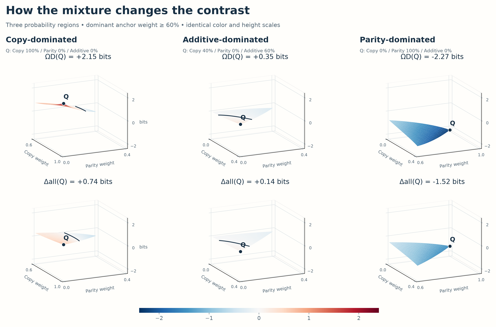

# Causal Dynamics Generators

Companion figures for [*Shaking the causal tree: On the faithfulness and minimality assumptions beyond pairwise interactions*](https://arxiv.org/abs/2203.10665v3), by Tiago Martinelli, Diogo O. Soares-Pinto and Francisco A. Rodrigues.


Generate **discrete IID mechanisms** and **binary lag-one processes**, with known functional parents and enumerable population laws. Continuous and mixed-state generators are planned.

[Documentation website](https://martinellitiago.github.io/causal-information-benchmark/) · [Quickstart](https://martinellitiago.github.io/causal-information-benchmark/quickstart.html) · [Discrete catalog](https://martinellitiago.github.io/causal-information-benchmark/discrete.html) · [Temporal catalog](https://martinellitiago.github.io/causal-information-benchmark/temporal.html) · [API](https://martinellitiago.github.io/causal-information-benchmark/api.html)

```bash
python -m pip install -e .
```

```python
from causal_dynamics.generators import DiscreteGenerator, BinaryProcess
from causal_dynamics.measures import omega_d

model = DiscreteGenerator("parity", n_sources=3, noise=0.1)
rows = model.sample(1000, seed=7)
profile = model.diagnostics()
value = omega_d(model.population(), sources=[0, 1, 2], target=3)

process = BinaryProcess("kinetic_product", persistence=0.65)
series = process.sample(1000, seed=7)
links = process.ground_truth()
```

**Generators and measures are separate:** `causal_dynamics.generators` defines processes; `causal_dynamics.measures` contains informational measures, including the proposed ΩD.

The core has no external dependencies. Population calculations and sampling are separate; the library does not yet estimate CMI from finite samples. To build the browsable documentation:

```bash
python -m pip install -e '.[docs]'
python -m sphinx -W -b html docs/source generated/docs
```

Open `generated/docs/index.html`. Model pages include update equations, noise, parameters, output columns and scope. The source repository is the installation target; no package-index release is claimed.

## Endpoint and intermediate information



Each column explores a region of the same probability simplex: **copy dominated, additive dominated, or parity dominated**. The named distribution has at least 60% mixture weight. Each anchor contains 8% uniform noise. All six panels share the same vertical and color scales.

**Top row — the paper's endpoint balance:**

$$\Omega_D=F-M=3(L_0-L_2).$$

**Bottom row — the exploratory contrast including intermediate conditioning:**

$$\Delta_{\mathrm{all}}=L_0+L_1+L_2-M=I(\mathbf X;Y)-M.$$

For three sources, L₀ averages the three marginal information values, L₁ averages the six intermediate conditional information values, and L₂ averages the three fully conditioned values. Thus F = 3L₀ and M = 3L₂. Equal weight is given to each conditioning depth. The sum of the depth means equals joint mutual information by the averaged chain rule.

Each Q marks the largest absolute gap between the two contrasts found on its regional grid. These are numerical grid extrema. The bottom row aggregates intermediate information; individual zero queries still require the complete local audit.

[Download the six-panel PDF](assets/omega-mixture-regions-en.pdf) · [Endpoint surface](assets/omega-explained-en.png) · [All-depth surface](assets/omega-surface-guide-en.png) · [Derivation and figure details](docs/INFORMATION_GEOMETRY.md)

## Reproduce the figures

```bash
python3.12 -m venv .venv
source .venv/bin/activate
python -m pip install -r requirements-dynamics-lock.txt
python -B scripts/plot_explainer.py
```

[Grid values](results/geometry/simplex.csv) · [Regional extrema](results/geometry/regional-extremes.json) · [Citation](CITATION.cff) · [MIT license](LICENSE)
