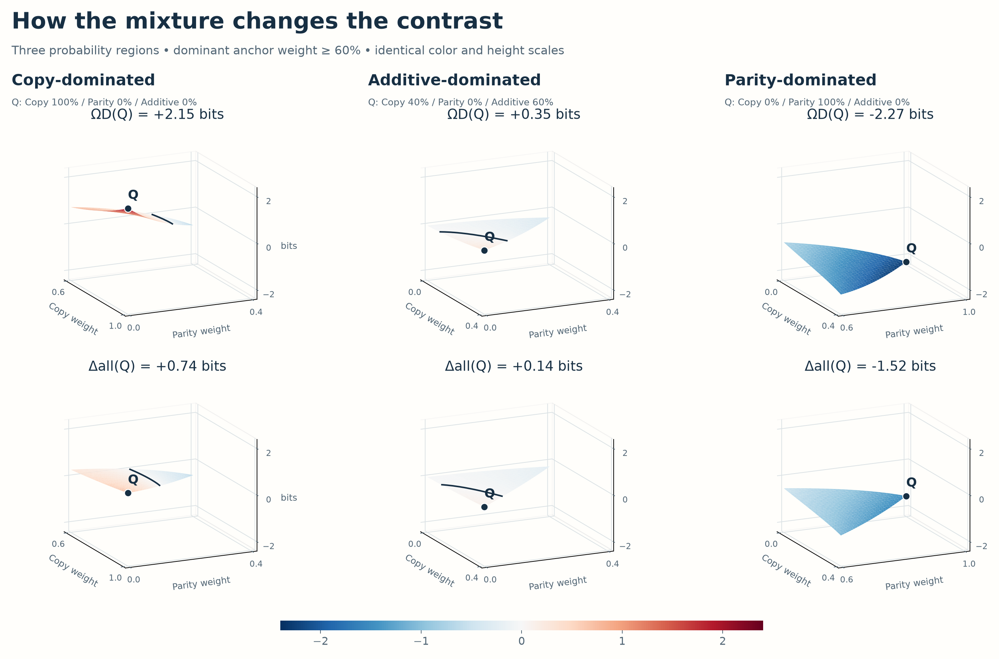

# Geometry of the endpoint balance and the full local audit

## Distribution regions and extrema

The six panels are three matched pairs: copy dominated, additive dominated, and parity dominated. Each domain is the triangular region where its named anchor has weight at least 0.60. These are different subsets of the original mixture family, not new stochastic mechanisms. Horizontal ranges differ by region; their widths are all 0.40. The vertical range, color scale and camera are shared. The central mixed region is not included in these three patches; it remains visible in the full-domain figures.

A resolution-30 triangular grid gives 496 points per region. For each region, Q maximizes `abs(ΩD−Δall)` on that grid. This is a numerical maximum over a declared grid, not a certified continuous optimum. [Recorded weights and values](../results/geometry/regional-extremes.json):

| Region | Q: copy / parity / additive | ΩD, bits | Δall, bits |
|:--|:--|--:|--:|
| Copy dominated | 100% / 0% / 0% | +2.15 | +0.74 |
| Additive dominated | 40% / 0% / 60% | +0.35 | +0.14 |
| Parity dominated | 0% / 100% / 0% | −2.27 | −1.52 |

Anchor weights refer to the regularized distributions: even a 100% anchor still includes its 8% uniform contamination. The three Qs emphasize amplitude differences; the separate Q in the full-domain pair emphasizes sign disagreement. Neither selection is a performance comparison of estimators.

## Read the two surfaces together

The views share their camera (16° elevation, −25° azimuth, orthographic projection), axes, and color range (−2.4 to +2.4 bits). The dark curve is each contrast's own zero contour. The underlying joint-law family is identical. The horizontal coordinates are copy weight r and parity weight s; the additive weight is `1−r−s`.

The highlighted **Q = 70% copy + 25% parity + 5% additive** illustrates sign disagreement. Its depth means are `L0 = 0.3397895`, `L1 = 0.0970260`, and `L2 = 0.2926168` bits. Thus `F = 1.0193686`, `M = 0.8778504`, and `ΩD = +0.1415183` bit. The exploratory all-depth contrast is `Δall = −0.1484180` bit. All local queries at Q remain positive: the sign comparison is not a demonstration of unfaithfulness.

This example was selected to make the distinction visible. It does not establish that either contrast is a better detector. Both means and sums can conceal individual zero queries. In particular, the all-depth field below is not the minimum-based local audit.

## What “including all depths” means here

For n sources, `Lk` is the uniform mean of `I(Xi;Y|S)` over all sources i and all k-element subsets of the other sources. There are `n × binom(n−1,k)` such queries. The endpoint measure and the already archived exploratory comparison are

$$\Omega_D=n(L_0-L_{n-1}),\qquad \Delta_{\rm all}=n\bar L-M=\sum_{k=0}^{n-1}L_k-M.$$

The second formula includes every conditioning depth with equal weight. It also admits an exact simplification:

$$\sum_{k=0}^{n-1}L_k=I(\mathbf X;Y),\qquad \Delta_{\rm all}=I(\mathbf X;Y)-M.$$

To see this, expand joint mutual information by the chain rule in each ordering of the sources and average over all n! orderings. At position k+1, each source and each admissible preceding k-subset occurs with equal frequency, giving precisely Lk. Summing over positions proves the identity. The plotting script verifies it at all 1,081 archived grid points; the tests also check different source counts.

Consequently, this aggregation compresses the full profile to joint information. It does not preserve every intermediate query. Its displayed amplitude also changes because the endpoint weights change: for three sources, the two coefficient vectors on `(L0,L1,L2)` are `(3,0,−3)` and `(1,1,−2)`. Shared graphical scales expose that difference without implying identical sensitivity.

**Changing the point changes the joint law; conditioning examines that same law in different ways.** The probability triangle organizes distributions. The conditioning hierarchy organizes the queries for each distribution. Each contrast assigns one height to each point in the triangle.

[Reproduce both English figures](../scripts/plot_explainer.py) · [Endpoint PDF](../assets/omega-explained-en.pdf) · [All-depth PDF](../assets/omega-surface-guide-en.pdf)

## Probability family and scope

The triangle mixes three laws on three binary sources and one binary target: equal-mass copy (`0000` or `1111`), fair independent sources with a parity target, and an additive target with probability `(1 + 0.25s1 + 0.30s2 + 0.35s3)/2`. Here `si = 2Xi−1`. Each anchor is replaced by `0.92 × anchor + 0.08 × uniform`, giving full support. Mixture weights are nonnegative and sum to one.

This is an illustrative joint-distribution family, not a fitted causal model. Neither aggregate contrast certifies local or global faithfulness. The figures compare the declared formulas on a reproducible numerical grid.
